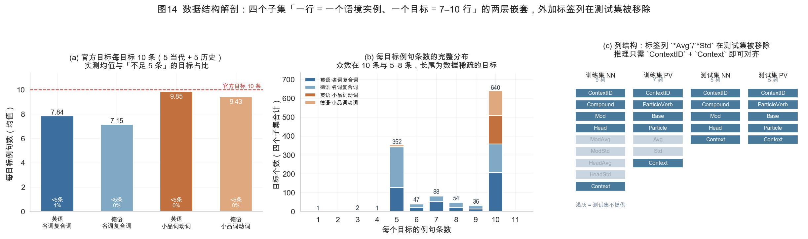
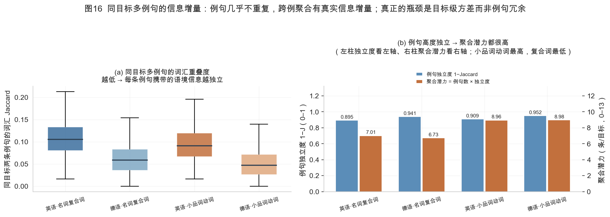

# ComPartMENT 数据分析报告

> **目的**：把 17 张实测图表逐张拆解为「这张图证明了什么 → 结论有多硬 → 对应采取什么处理动作」，
> 使每一个建模决策都有可复现的数据支撑，而不是经验判断。
>
> **数据**：`train/{en,de}-{nn,pv}-train.tsv`（官方训练集，2026-09-08 发布）
> **复现**：
> ```bash
> python3 scripts/run_eda.py             # 图 1-11  + scripts/stats.json
> python3 scripts/run_ctxvar.py          # 图 12     + scripts/context_variance.json
> python3 scripts/run_era_effect.py      # 图 13     + scripts/era_effect.json
> python3 scripts/run_structure.py       # 图 14     + scripts/data_structure.json
> python3 scripts/run_label_structure.py # 图 15-17  + scripts/label_structure.json
> ```
> **本文所有数字均由上述脚本在本地数据上实测得出，无估计值、无引用二手结论。**
>
> 📌 **v3 修订**：本阶段新增图 15–17，并完成一项**此前一直缺失的基础工作**——把标签
> `Avg`/`Std` 的数值构造精确反解出来。这一步推翻了前一轮关于「标注噪声量级」的判断，
> 本文的 §7 与图 17 已按实测值重写。

---

## 0. 摘要：七个必须写进代码的结论

| # | 结论 | 硬度 | 支撑 | 对应动作 |
|---|---|---|---|---|
| ① | **`ContextID` 编码的是金标，不是年代**。零文本基线在两个 PV 子集上即达到 ρ=0.62/0.52，已超过 ComposiGen 已发表的最好系统（0.50） | 已被三条独立证据交叉验证 | 图 11 | 载入即删列 + 物理打乱 + 禁止行号衍生特征 + 设地板自检 |
| ② | **定位失败即报废**：简单子串匹配漏掉 66%–79% 的例句 | 实测 | 图 7、图 8 | 四级级联定位，德语 PV 必须接形态分析器 |
| ③ | **不要全量剥离括号**——只有 0/18 例的末位括号是标注标记 | 实测推翻直觉 | 图 10 | 只保留原文，不做正则剥离 |
| ④ | **指标 2 是硬门槛**：type-level 系统输出恒定 → 组内 std ≡ 0 → ρ = `nan` | 指标定义的直接后果 | 图 12 | 训练期就必须让输出随语境变化，不能靠后处理加噪声 |
| ⑤ | **年代代理刷不了指标 2**，也不该入模：覆盖率仅 6%–38%，|ρ| ≤ 0.17 且符号跨子集翻转 | 实测 | 图 13 | 年代特征只做分层评估 |
| ⑥ | **标签 = 10 个 0-5 整数评分的均值，Std = 这 10 个评分的样本标准差**（91.2%–97.8% 的行可精确重建） | 数值反解 + 重建验证 | 图 15、图 17(a) | 均值噪声 = Std²/10；噪声天花板从 0.46–0.62 修正为 **0.85–0.93** |
| ⑦ | **例句不是冗余的**：同目标例句词汇独立度 0.89–0.95、完全重复 0% → 跨例聚合有真实信息增量；真正的瓶颈是**目标级方差**（`de-nn` 极差中位仅 0.70） | 实测 | 图 16 | 资源优先投 `en-pv`/`de-pv`；`de-nn` 不宜重投入 |

---

## 1. 规模与结构（图 1、图 14）




### 图 1 说了什么

四个子集的规模极不均衡：`en-nn` 3,480 例句 / 444 目标，`de-pv` 1,490 例句 / 158 目标——
**例句数相差 2.3 倍，目标数相差 2.8 倍**。

**这一张图唯一的作用是：提醒你「总分」没有意义。**
任何跨子集相加的单一指标都会被 `en-nn` 主导。官方报告的是 **6 个评测设置**
（NN 拆成 modifier/head 两列）+ 跨设置均值，本地评估必须复刻这个结构。

> **处理动作**：所有结果按 `语言 × 类型 × 成分角色` 六格分层报告，总分只作附加项。
> 训练时把子集 one-hot 作为显式特征，或至少做分层采样。

### 图 14 说了什么

图 14 是**数据契约图**，把三件此前靠口口相传的事实固化成可验证的表格：

| 事实 | 实测 | 为什么重要 |
|---|---|---|
| 列结构 | NN = 9 列，PV = 7 列；**测试集不含 `*Avg`/`*Std`** | 推理入口必须容忍缺列，否则在测试集上直接崩 |
| 成分拼接律 | `en-nn`：`Mod + " " + Head` = **100%**；`de-nn`：`Mod + lower(Head[0]) + Head[1:]` = **仅 59.1%** | **德语复合词不能用字符串切片还原**（Fugen-s 等连接成分） |
| 词序律 | `en-pv`：`Base + " " + Particle` = 100%；`de-pv`：`Particle + Base` = 100%（**无空格，粒子在前**） | **英语是「基干+粒子」，德语是「粒子+基干」，顺序相反** |
| 组内连续性 | `de-nn` 的 `ContextID` 在同目标内连续（gap=1）；PV 不连续 | 德语划分的组结构与英语不同，跨子集不能共用划分逻辑 |

成分角色不对称（`en-nn` 中心语更高 57.1%，`de-nn` 仅 25.5%，方向相反）说明
**modifier 与 head 是两个近乎独立的监督信号**。

> **处理动作**：NN 建两个回归头，不要合并成一个 `compound_mean`；德语复合词的
> 修饰语/中心语切分必须靠形态学，不能靠字符串；`de-nn` 与 `en-nn` 的
> 目标-例句组结构不同，划分代码要按子集分别处理。

---

## 2. 标签分布：不均衡到必须分组（图 2、图 5）


### 图 2 说了什么

| 子集 / 列 | 均分 | [0,1) | [1,2) | [2,3) | [3,4) | [4,5] | ≥4.5 |
|---|---|---|---|---|---|---|---|
| `en-nn` ModAvg | 3.66 | 2.0% | 5.5% | 13.0% | 32.8% | 46.8% | 22.1% |
| `en-nn` HeadAvg | 3.91 | 0.9% | 3.0% | 9.9% | 28.2% | 58.1% | 32.9% |
| `de-nn` ModAvg | 4.32 | 0.5% | 0.7% | 3.9% | 15.4% | **79.4%** | **55.2%** |
| `de-nn` HeadAvg | 3.60 | 2.8% | 9.4% | 15.9% | 21.7% | 50.3% | 30.9% |
| `en-pv` Avg | 2.46 | 7.8% | 27.0% | 32.0% | 22.3% | 11.0% | 3.4% |
| `de-pv` Avg | 2.63 | 6.4% | 22.5% | 30.2% | 29.1% | 11.8% | 3.2% |

关键落差：**`de-nn` 的 `ModAvg` 有 79.4% 落在 [4,5]、55.2% ≥ 4.5**，
而 `en-pv` 只有 11.0% / 3.4%。`de-nn` ModAvg 几乎是**天花板标签**——
这个子集上的「预测得高」几乎没有信息量。

> **处理动作**：
> 1. **损失函数按子集分组或分组加权**，`de-nn` 降权——直接用统一 MSE，梯度会被 `de-nn` 主导，
>    而 `de-nn` 恰恰是四个子集里**最简单**的那个（跨语境极差中位仅 0.70）。
> 2. 极端值不要裁剪：标签严格落在 0–5 内（见 §6），裁剪会破坏与指标的对应关系。
> 3. 若做标准化，必须**在导出前反变换回 0–5 原尺度**——RMSE 对尺度错误是灾难性的。

### 图 5 说了什么


| 子集 | ModAvg 均值 | HeadAvg 均值 | 中心语更高 | ModAvg~HeadAvg ρ |
|---|---|---|---|---|
| `en-nn` | 3.66 | 3.91 | **57.1%** | 0.224 |
| `de-nn` | 4.32 | 3.60 | **25.5%** | 0.152 |

两子集的**优势方向相反**，且两列相关性都很低（0.15–0.22）。

> **处理动作**：modifier 与 head 分头建模。英德两个子集的「中心语优势方向相反」
> 也说明不能用一个跨语言共享的「中心语偏置」特征——让模型自己学。

---

## 3. 语境依赖强度：这是本任务的真正难点（图 3、图 4、图 16）


### 图 3 说了什么

| 子集 | 跨语境极差中位 | 极差 ≥1 的目标 | 极差 ≥2 的目标 |
|---|---|---|---|
| `en-nn` | 1.40 | 81.3% | 16.7% |
| **`de-nn`** | **0.70** | 32.5% | **2.6%** |
| **`en-pv`** | **2.30** | 98.1% | **59.5%** |
| `de-pv` | 1.75 | 94.9% | 39.2% |

**近 20 倍的难度差被一个总分掩盖了。** `de-nn` 基本是 type-level 稳定任务
（只有 2.6% 的目标极差 ≥2），`en-pv` 则极端语境依赖（59.5% 的目标极差 ≥2）。

> **处理动作**：
> 1. **不能用一套超参打天下**。至少按「`en-pv`/`de-pv`（强语境依赖）」与
>    「`en-nn`/`de-nn`（弱语境依赖）」分组调参。
> 2. `de-nn` 上指标 2 本来就难拿（人工 std 中位 0.279），但**这不是放弃的理由**——
>    它的 std 向量反而更稳定（CV 0.071），相关性算出来更可信。

### 图 4 说了什么


逐例句轨迹图。**看图时必须知道**：横轴是 `ContextID`（人为排序），
所以曲线形状里的单调性是 §5 的**行序伪影**，不是历时趋势。

每个面板左上角标出 **ρ =「例句序号 vs 评分」的 Spearman 秩相关**，实测结果：

| 子集 | 面板 ρ 范围 | 判定 |
|---|---|---|
| `en-nn` | +0.00 / +0.89 / +0.53 | 波动大的目标 ρ 可以接近 0（`dog dinner` 先升后降） |
| `de-nn` | +0.95 / +0.13 / +0.58 / **-0.87** | `Internetseite` 随 `ContextID` **单调下降** |
| `en-pv` | **+1.00** / +0.99 / +0.99 / +0.99 | 几乎全部单调上升 |
| `de-pv` | **+1.00** / +1.00 / +0.95 / +0.97 | 几乎全部单调上升 |

> **⚠️ 一个必须记住的细节**：只有**小品词动词**（第三、四行）呈强单调上升；
> **名词复合词行并不单调**——`de-nn` 的 `Internetseite` 甚至是**下降**的（ρ = -0.87）。
> 所以「行序伪影在小品词动词上最强」这一结论**只对 PV 成立**，
> 不能推广到全部子集；NN 的行序泄漏机制与 PV 不同（见 §5 与图 11）。

**这幅图的正确用法是看形状**（哪些目标的曲线是平的、哪些是锯齿状的），
不是看斜率。

> **处理动作**：图 4 只在方法节用作「语境依赖性可视化」示例，且**必须在图注中
> 声明行序是人为排序**——否则审稿人会读成「组合性随时间下降」，而这个假设
> 已被 Jenkins et al. (2026) 否定。

### 图 16 说了什么



图 16 回答一个此前没被问过的问题：**同目标的多条例句之间，重复了多少信息？**

| 子集 | 同目标两条例句词汇 Jaccard 中位 | 独立度 1−J | <0.1 的占比 | 完全重复 | 每目标例句数 | 聚合潜力 = 例句数 × 独立度 |
|---|---|---|---|---|---|---|
| `en-nn` | 0.105 | 0.895 | 43.3% | 0.0% | 7.84 | 7.01 |
| `de-nn` | 0.059 | 0.941 | **84.7%** | 0.0% | **7.15** | 6.73 |
| `en-pv` | 0.091 | 0.909 | 57.8% | 0.0% | 9.85 | 8.96 |
| `de-pv` | **0.048** | **0.952** | **90.2%** | 0.0% | 9.43 | **8.98** |

> **图 16(b) 读图须知**：左柱（例句独立度，量纲 0–1）读**左轴**，
> 右柱（聚合潜力，量纲 0–10 条/目标）读**右轴**。两个量纲不同，**柱高不可直接相比**。

三条推论：

1. **完全重复 0.0%**（`de-pv` 为 0.02%）——同目标的多条例句几乎不共享词汇，
   **跨例聚合有真实信息增量**，不是在把同一件事重复十遍。
   全部四个子集的独立度都在 0.89–0.95 之间。
2. **德语的例句最不重复**（`de-pv` 独立度 0.952），意味着**每条例句携带的新信息最多**——
   对跨例聚合而言这是**有利**的，不是劣势。
3. **真正的瓶颈不是例句冗余，而是目标级方差**：`de-nn` 聚合潜力最低（6.73），
   但根本原因是它的**跨语境极差中位仅 0.70**（只有 2.6% 的目标极差 ≥2）——
   就算聚合做得再好，标签本身也没什么方差可预测。
   `en-pv`/`de-pv` 聚合潜力最高（8.96/8.98），且跨语境极差最大（2.30/1.75），
   **这两个子集才是指标 2 的主战场**。

> **处理动作**：
> 1. **必须 token-level 逐例预测 + 跨例聚合**，不能先聚合成 type-level 再回归。
>    每目标 5–10 条例句正处在 EACL 2023 边际收益曲线最陡的区域（10→100 条 +0.067，
>    100→1000 只 +0.017）。
> 2. 聚合方式要用**可学习的**（如 target-level attention / pooling），不要用固定平均——
>    固定平均会压平输出方差，直接伤害指标 2。
> 3. **把资源优先投在 `en-pv` 与 `de-pv`**：它们聚合潜力最高、语境方差最大，
>    指标 2 的区分度也在这里。`de-nn` 上不要投入过多建模精力。

---

## 4. 标注分歧：不是脏数据（图 6、图 15b）


### 图 6 说了什么

| 子集 | Std 均值 | Std > 1.0 | Std > 1.5 |
|---|---|---|---|
| `en-nn` | 1.376 | 71.7% | 52.9% |
| `de-nn` | 0.965 | — | — |
| `en-pv` | 1.751 | — | 60.7% |
| `de-pv` | 1.508 | — | 54.8% |

散点图还显示一个结构性事实：**评分越低，标注分歧越大**。

**不要用 Z-score 或阈值剔除「异常行」。** Roller, Schulte im Walde & Scheible (MWE 2013)
的噪声注入实验表明：把 25% 条目替换为随机值后，Z-score 过滤完全无法恢复一致性；
而基于被试一致性（MSA）的清洗有效，垃圾用户识别率 81.5%。
**标注大方差是任务的固有属性（Type I 不确定性），不是标注事故。**

> **处理动作**：
> 1. **保留全部样本**，一行不删。
> 2. `Std` 用作**样本权重**（高分歧降权）或**辅助回归目标**，
>    **不要**用作标签平滑系数（平滑会直接压平输出方差，伤害指标 2）。
> 3. 若确实要做清洗，只能用基于被试一致性的方法，且必须在 dev 上证明指标 1、2 同时改善。

---

## 5. 行序泄漏：本项目最重要的发现（图 11）


### 图 11(a) 说了什么

一个**完全不看句子**的基线：预测分数 = 该行在所属目标内的序号秩，线性映射到 0–5。

| 子集 | 全量 ρ | 逐行随机 8:2 | MWE 互斥 8:2 |
|---|---|---|---|
| `en-nn` | 0.187 | 0.180 | 0.211 |
| `de-nn` | 0.127 | 0.079 | 0.110 |
| **`en-pv`** | **0.623** | 0.682 | **0.596** |
| **`de-pv`** | **0.521** | 0.519 | **0.507** |

标尺：ComposiGen（LREC 2026）已发表最好系统 **ρ = 0.50**；Couch Potato（ACL 2025）
纯文本 Skip-gram **0.565**。

> **在两个小品词动词子集上，一个连句子都不看的平凡基线，已经达到了已发表最好系统的水平。**

**为什么这特别危险**：随机划分**不会暴露**这个问题（左右两列数值接近）；
MWE 互斥划分**也挡不住**（该捷径只用组内相对次序，在完全没见过的目标上依然有效）。
**常规验证协议无法自证清白。**

### 图 11(b) 说了什么

| 标签列 | 相邻上升对占比 | 组内 Spearman(ContextID, 分数) | ρ>0.5 的目标占比 |
|---|---|---|---|
| `en-nn` ModAvg | 0.527（≈随机） | 0.298 | 34.2% |
| `en-nn` HeadAvg | 0.782 | **0.985** | **100%** |
| `de-nn` ModAvg | 0.480（≈随机） | 0.221 | 30.4% |
| `de-nn` HeadAvg | 0.757 | **0.976** | **100%** |
| `en-pv` Avg | 0.851 | **0.994** | **100%** |
| `de-pv` Avg | 0.810 | **0.990** | **100%** |

**关键的非对称性**：行序编码的是**中心语贡献 / 整体评分**，而**修饰语贡献是随机顺序**。
这个非对称性本身就说明它是**数据构造过程的产物**，不是语言现象。

**「年代序」这一解释已被三条独立证据排除**：

1. 句中显式年份与 `ContextID` 的 Pearson：+0.034 / −0.015 / +0.079 / −0.128；
2. 同目标内，年份秩与 ContextID 秩的相关为负（`de-nn` 20 个可测样本中 75% 为负）；
3. 逐条人工核验：`brass ring` 第 2 行提到 Rihanna（2000 年代），第 5 行是 19 世纪小说——顺序与年代相反。

> **处理动作（不可协商）**：
> 1. 载入后**立即删除 `ContextID`**，不做 `astype(int)`，不派生任何特征。
> 2. 读完 TSV **立刻 `sample(frac=1, random_state=42)`** 打乱物理行序。
> 3. **禁止**组内序号、文件内绝对位置、与相邻行的差分等一切行号衍生特征。
> 4. **每次建管线先跑「组内秩」基线**；若某模型低于它，说明管线有 bug，而不是模型不行。
> 5. 论文方法节**必须写明**这个地板值（0.62/0.52），提醒读者不要误读成绩。

---

## 6. 标签的数值构造（v3 新增，图 15）


这一节回答一个此前被含糊带过的问题：**`Avg` 和 `Std` 到底是什么算出来的？**
答案不是「估计一下」，而是**精确反解**。

### 6.1 构造假设

设 n 个 0–5 的整数评分 x₁…xₙ，则

```
Avg = S/n                    (S = Σxᵢ 为整数)
Std² = (n·Q − S²) / (n·(n−1))     (Q = Σxᵢ² 为整数, ddof=1)
```

取 n = 10 时代码为 `Avg = S/10`、`Std² = (10Q − S²)/90`，于是有四个**可检验的矩条件**：

| 条件 | 判据 | 含义 |
|---|---|---|
| A | `10·Avg ∈ ℤ` | 和 S 是整数 |
| B | `90·Std² ∈ ℤ` | `10Q − S²` 是整数 |
| C | `Q = (90Std² + S²)/10 ∈ ℤ` | 平方和是整数 |
| D | `Q ≤ 5S` 且 `Q ≥ S` 且 `S² ≤ 10Q` | 0–5 取值范围的必要约束（x²≤5x, x²≥x, Cauchy） |

### 6.2 实测结果

| 子集/列 | A 命中 | B 命中 | C 命中 | **完整重建 10 个评分** | `|90Std²−round|` p90 |
|---|---|---|---|---|---|
| `en-nn` ModAvg | 97.8% | 98.8% | 97.7% | **97.7%** | 0.00134 |
| `en-nn` HeadAvg | 98.1% | 99.1% | 97.8% | **97.8%** | 0.00124 |
| `de-nn` ModAvg | 96.0% | 96.5% | 95.8% | **95.8%** | 0.00102 |
| `de-nn` HeadAvg | 96.2% | 96.8% | 95.9% | **95.9%** | 0.00116 |
| `en-pv` Avg | 92.0% | 94.9% | 91.3% | **91.2%** | 0.00142 |
| `de-pv` Avg | 97.3% | 98.0% | 96.9% | **96.9%** | 0.00127 |

**交叉验证**：条件 A（`10·Avg` 是整数）与「`Avg` 落在 0.1 格点」在数学上是同一件事，
实测两者命中率**逐项完全相同**（97.8/98.1/96.0/96.2/92.0/97.2%）——这是 n=10 假设
最直接的独立佐证（图 15(a)）。

**残差 p90 ≈ 0.0013 是浮点精度量级**（不是离散噪声），这说明
`90·Std²` 落在**精确的 1/90 网格**上。四个子集里 **91.2%–97.8% 的行可以完整重建出
10 个 0–5 的整数评分**（重建后 mean 与 std 的最大误差 2.3e-2，来自 6 位小数舍入）。

**结论：n = 10、ddof = 1 的构造被证实。** 剩余 2%–9% 的行来自不同的 n
（部分行是 0.1 格点但不在 1/90 网格上，说明标注者数不是 10）。

### 6.3 图 15 三个面板各说了什么

**(a) 评分的十进制格点**——各列「落在 0.1 格点上的行占比」为
**97.8% / 98.1% / 96.0% / 96.2% / 92.0% / 97.2%**。
这与 n=10 的矩条件命中率**逐项完全相同**（因为「10·Avg 是整数」与「Avg 落在 0.1 格点」
在数学上是同一件事）——这是 n=10 假设最直接的交叉验证。
柱内小字标出该列的**最大离格误差**：**0.045–0.050 分**（= 0.45–0.50 个 0.1 格），
说明剩下的少数行来自不同的 n（均值如 2.05、2.333 之类），
但**偏离仍在 0.05 分以内**——不是数据错误，只是标注者人数不等于 10。
柱内上方的白字百分比即为格点命中率，红色虚线 `1.0` 是「全部落在格点」的理论上界
（**标签画在柱内，参考线不与任何数字相交**）。

**(b) 「均值² + 方差 ≤ 25」恒成立**——四个子集**零行超界**，
且上界恰在 25.0000 处取到。这意味着标注值被严格约束在 0–5 内
（由 x∈[0,5] 直接推出：mean² + var ≤ E[x²] ≤ 25）。

**(c) 目标级 std 的可算性**——`en-nn` 443/444（1 个单例目标）、
`de-nn` 461/461、`en-pv` 158/158、`de-pv` 158/158，
**零 std 目标 0 个**。
即 **1220/1221 个目标**都能算出非零 std，唯一缺口是 `en-nn` 的 1 个**单例句**目标
（样本数 < 2，std 数学上未定义）——这不是「零方差退化点」，
而是「样本量不足」，两者的处理方式完全不同：
零方差意味着**指标 2 在该目标上无定义**（必须规避），
单例句只影响 1/1221 的目标量，**对指标 2 无实质影响**。

> **处理动作**：
> 1. **回归头输出连续值 + 辅助头**，不要把标签当离散投票处理。
> 2. 指标 2 的被解释变量（目标级人工 std）**没有零方差退化点**——
>    风险完全在**模型侧**：输出恒定 → 组内 std ≡ 0 → ρ = `nan`。
> 3. `Std²` 可以被当作**逐行的噪声尺度**用于样本加权。

---

## 7. 噪声天花板：被修正 10 倍的关键数字（v3 新增，图 17）


### 7.1 修正的来源

`Std` 是 **10 个标注者评分的样本标准差**，而 `Avg` 是**这 10 个评分的均值**。
均值的抽样噪声方差是 `Std²/n = Std²/10`，**不是 `Std²`**。

**前一轮把 `Std²` 直接当作「均值的噪声」使用，把噪声高估了 10 倍，
把可达上限严重低估了。** 这是本阶段最重要的修正。

| 子集/列 | 标注者间离散度 `Std²` | 均值噪声 `Std²/10` | 目标级信号方差 | 信噪比 | **修正后上限** | 误用 `Std²` 的错误上限 |
|---|---|---|---|---|---|---|
| `en-nn` ModAvg | 2.406 | 0.241 | 0.771 | 3.21 | **0.873** | 0.493 |
| `en-nn` HeadAvg | 2.116 | 0.212 | 0.576 | 2.72 | **0.855** | 0.463 |
| `de-nn` ModAvg | 1.291 | 0.129 | 0.370 | 2.87 | **0.861** | 0.472 |
| `de-nn` HeadAvg | 1.844 | 0.184 | 1.125 | 6.10 | **0.927** | 0.616 |
| `en-pv` Avg | 2.509 | 0.251 | 0.629 | 2.51 | **0.845** | 0.448 |
| `de-pv` Avg | 2.380 | 0.238 | 0.727 | 3.05 | **0.868** | 0.484 |

> **图 17 口径**：三个面板 (a)(b)(c) **全部覆盖这 6 个「子集×列」**，
> 不是每个子集只取首列。图中 (c) 的 6 根柱依次为
> `en-nn` ModAvg / `en-nn` HeadAvg / `de-nn` ModAvg / `de-nn` HeadAvg / `en-pv` Avg / `de-pv` Avg，
> 数值与上表逐项一致；柱顶白字为修正后上限，柱内红色虚线为「误用 `Std²`」的错误上限。

### 7.2 这组数字怎么用

- **指标 1 的 ρ 理论上限是 0.85–0.93，不是 0.46–0.62。**
  这意味着「模型只做到 ρ=0.6」**不是标签噪声的锅**，而是模型确实还有空间。
  调参时不要在 0.6 附近就以为「到顶了」。
- 信噪比 2.5–6.1，说明**标签整体是「够用」的**：`de-nn` HeadAvg 最干净（信噪比 6.1），
  `en-pv` 最脏（2.51）——与「`en-pv` 最语境依赖」的结论方向一致。
- 上限最低的 `en-pv`（0.845）恰好也是**指标 2 最有区分度的子集**，
  两者是同一件事的两面。

> **处理动作**：
> 1. **不要因为「标注噪声大」而放弃 `en-pv`**——它仍有 0.845 的空间。
> 2. 优化目标里**不要**用「预测标签的绝对值」为主——绝对值里混着 `Std²/10` 的噪声；
>    更有前景的是**同目标内的相对排序**（直接对应指标 2，且对噪声不敏感）。
> 3. 报成绩时**不要**把 ρ=0.85 当成「满分 1.0 的 85%」来解读——
>    那是「完美预测真值后仍会被噪声压低」的上界，不是「及格线」。

---

## 8. 三项指标的实测可达成性（图 12）


### 8.1 图 12(a)(b)：指标 1 与 3 单独看并不强制用语境

构造「作弊上界」——每条例句都填该目标的真实均值：

| 子集 | 标签列 | 指标1 ρ | 指标3 RMSE |
|---|---|---|---|
| 英·复合词 | `ModAvg` | 0.790 | 0.512 |
| 英·复合词 | `HeadAvg` | 0.771 | 0.502 |
| 德·复合词 | `ModAvg` | 0.780 | 0.329 |
| 德·复合词 | `HeadAvg` | **0.918** | 0.407 |
| 英·小品词动词 | `Avg` | 0.702 | 0.756 |
| 德·小品词动词 | `Avg` | 0.798 | 0.640 |

**含义**：只要能猜对每个目标的均值，指标 1 就能拿 ρ ≈ 0.70–0.92。
**指标 1 与 3 单独看并不强制你使用语境。**

### 8.2 图 12(b)：指标 2 是硬门槛

**上表所有 type-level 方案，指标 2 全部为 `nan`**——因为每个目标内所有预测值相同，
std 恒为 0，相关系数的输入数组是常数。

> **这是本任务最有辨识度的设计：指标 2 把「你到底用没用语境」变成了硬性门槛。**
> 在指标 1 上表现不错的 type-level 系统，会在指标 2 上直接失去名次。

### 8.3 图 12(c)：指标 2 的样本量

| 子集 | 标签列 | 可算 std 的目标数 | std 中位 | 变异系数 |
|---|---|---|---|---|
| 英·复合词 | ModAvg / HeadAvg | 443 | 0.476 / 0.472 | 0.139 / 0.127 |
| 德·复合词 | ModAvg / HeadAvg | 461 | 0.279 / 0.365 | 0.071 / 0.105 |
| **英·小品词动词** | `Avg` | **158** | **0.730** | **0.305** |
| 德·小品词动词 | `Avg` | 158 | 0.578 | 0.238 |

图 12(c) 每组两根**并排**柱：浅蓝 = 该子集可算 std 的目标数，
橙 = 其中 std 达到本子集最大值 25% 的目标数（443→324、443→339、
461→252、461→311、158→147、158→142）。
**注意：橙柱是浅蓝柱的子集，不是堆叠关系**——两柱高度不可相加。

复合词 443–461 个目标足够稳健；**PV 只有 158 个**，指标 2 在 PV 上的方差很大，
**不要过度解读 0.05 量级的差异**。

> **处理动作**：
> 1. **绝对禁止输出常数**——每条例句的预测分必须随语境变化。
> 2. 指标 2 **只能通过建模获得**。不能靠后处理加噪声「制造」方差，
>    那会同时抬高 std 却破坏指标 1 的排序。
> 3. **加一个辅助回归头**，以「目标级人工 std」为预测量，与主任务联合训练。
>    目标级 std 可由 `groupby(target)[label].std()` 直接算出。
> 4. 同目标内**成对排序损失**天然有利于指标 2（只关心目标内部相对顺序，
>    对绝对幅度不敏感）；回归绝对值则必须显式控制输出方差。
> 5. **本地必须复现全部三个指标**，并用 Trial 的 `scores.txt` 对齐官方实现。
> 6. 导出前**显式断言组内标准差非零**。

### 8.4 两个指标的冲突与调参方式

指标 1/3 奖励**跨目标的数值校准**，指标 2 奖励**目标内部的离散程度**，二者存在张力：

- 过度压缩输出方差 → 指标 2 掉分
- 过度放大方差 / 加噪声 → 指标 1 的排序被破坏、RMSE 变差

> **处理动作**：把「输出缩放系数」当作一个**显式旋钮**，在 dev 上画
> **指标1 ρ vs 指标2 ρ 的帕累托前沿**，而不是用单一验证指标选点。
> 这也是论文里一个可以写的分析点。

---

## 9. 目标表达定位（图 7、图 8）


### 图 7/8 说了什么

| 级别 | 策略 | `en-nn` | `de-nn` | `en-pv` | `de-pv` |
|---|---|---|---|---|---|
| **S0** | 精确子串匹配 | 98.6% | 95.9% | 33.6% | 20.8% |
| **S1** | 历史转写还原（`ß→ss`、`ä→ae`、NFKD 折叠） | +0.0 | **+4.0** | +0.0 | +0.1 |
| **S2a** | 德语前缀型（粒子黏着词首 + 词干前缀命中） | — | +0.1 | — | **+49.3** |
| **S2b** | 德语后置型（动词与粒子分离，`klingen … ab`） | — | +0.0 | — | **+7.5** |
| **S3** | 词干前缀匹配（前 5/4/3 字符） | **+1.4** | +0.0 | **+52.6** | — |
| **S4** | 相邻双词窗口 | +0.0 | +0.0 | +0.1 | — |
| **累计** | | **100.0%** | **100.0%** | **86.3%** | **77.7%** |

> **图 7 读图须知**：每根柱代表**一条规则单独救回的增量**（不是累计值）。
> 增量 ≥ 8 个百分点的规则，数值白字画在色带内部；增量较小的规则，
> 数值画在**该色带下方的空白区**并用细连接线指向它所属的色带——
> 这样小增量既不压在 100% 参考虚线上，也不被色带遮住。

**关键**：英语 PV 的 66% 缺口全在 **S3 词干前缀**（屈折：`boil down → boiled down`、
`strike down → struck down`）；德语 PV 的 78% 缺口是 **S2a 前缀型**（屈折）+
**S2b 分离型**（`klingen … ab`）。

德语粒子 `ab/an/aus/auf` 在 **100%** 的例句中字面出现 → **粒子锚定是有效策略**。

> **处理动作**：
> 1. 实现四级级联，**记录每条例句命中的策略级别**并作为一列元数据输出。
> 2. **德语 NN / PV 的未定位比例（0% / 22.3%）不得静默丢弃**——
>    `de-pv` 剩下的 332 例恰好是最难的小品词动词（`ablehnen → abgelehnt`），
>    丢弃会**系统性损失信号**。
> 3. `de-pv` 剩余 22.3% 必须接入真正的形态分析器（推荐 **RPN** 或 **DeepMorph**）；
>    `en-pv` 剩余 13.7% 用 **spaCy / CoreNLP lemmatization** 后重试。
> 4. 定位失败率按子集分别报告，作为**数据质量指标**写进论文。

---

## 10. 括号处理：一条被实测推翻的直觉（图 10）


**常见误判**：「句尾的 `(目标词 )` 是标注标记，应统一剥离」。

| 检查项 | `en-nn` | `de-nn` | `en-pv` | `de-pv` |
|---|---|---|---|---|
| 含括号的例句比例 | 7.0% | 10.3% | 3.9% | 7.0% |
| 句尾以 `)` 结尾的例句数 | 2 | 6 | 5 | 5 |
| **末位括号内容 == 目标词** | **0/2** | **0/6** | **0/5** | **0/5** |

**这些括号是语料原文中正当的括注**（文献引用、计量单位、旁注）：
`(looking at my account book`、`(60 x 34 cm`、`(when she settles down...`、`(und es ist ihr reiz`。

**左图 (a)**：无条件剥离所有括号后，`en-pv` 有 **66.7%** 的例句再也定位不到目标
（`de-pv` 为 79.4%），因为剥离会连带删掉句中真正承载目标词的那一段。

> **处理动作**：
> 1. **不要**做正则全量括号剥离。
> 2. 若确需清理，只处理末尾形如 `( … )` 且内层长度 ≤ 目标词长度 + 2 的单个括号；
>    本数据上此规则命中 **0 例**，实际等同于不做。
> 3. 另存一份 `Context_raw` 保证可回溯。
> 4. 定位一律在**原文偏移**上完成（`locate()` 返回 `(start, end)` 字符区间），
>    不要在归一化后的字符串上做，否则词边界会被破坏。

---

## 11. 年代代理：一条走不通的捷径（图 13、图 9）


### 图 13 说了什么

官方披露「每目标 5 条当代 + 5 条历史」，这引出一个值得验证的假设：
**只要能判断一句是当代还是历史，让输出在这个方向上离散，就可能白拿一部分指标 2。**

| 子集 | 标签列 | 覆盖率 | 信号子集内全局 ρ | 目标内 ρ 均值 | 目标级 ρ（era.std vs 人工 std） |
|---|---|---|---|---|---|
| 英·复合词 | `ModAvg` | 6.7% | +0.007 | +0.028 | +0.078 |
| 英·复合词 | `HeadAvg` | 6.7% | −0.033 | −0.040 | −0.096 |
| 德·复合词 | `ModAvg` | 36.2% | +0.035 | −0.019 | +0.006 |
| 德·复合词 | `HeadAvg` | 36.2% | −0.110 | −0.024 | **+0.153** |
| 英·小品词动词 | `Avg` | 6.2% | +0.024 | −0.008 | **−0.169** |
| 德·小品词动词 | `Avg` | 37.6% | +0.035 | +0.066 | +0.018 |

**捷径不成立，三条证据**：

1. **信号太稀疏**——英语只有 6.2%–6.7% 的例句能被触发；
2. **相关性全在噪声区间**——所有 |ρ| ≤ 0.17；
3. **方向不稳定**——`de-nn` Head 上「年代感越高评分越低」（−0.110）看着成立，
   但同一列的目标级离散度却是**正**相关（+0.153）；`en-pv` 更是显著为负（−0.169）。
   跨子集、跨列符号翻转 → **采样噪声，不是机制**。

> **这也反过来证明指标 2 是一个真正有区分度的指标**——它既淘汰 type-level 常数输出，
> 也无法被表面特征糊弄，只能靠真正的逐例句语境敏感性拿到。

### 图 9 说了什么


表层年代代理特征的覆盖率。`ß`（德语 22.4%/27.5%）与 ASCII 转写（`ae/oe/ue` 替代变音，
德语 6.7%–7.1% 的句子）是最强的历史信号——`Arbeitsfähigkeit` 与 `Arbeitsfaehigkeit`
在同一份数据里并存。

> **处理动作**：
> 1. 年代代理 `era_proxy` **仅用于分层评估与误差分析**，不进入模型。
> 2. 不得使用任何给定的年代元数据（测试集本来也不公开）；
>    基于文本表面推断的年代特征原则上允许，但本数据上**实测无用**。
> 3. 若将来要入模，必须先在 dev 上证明它能**同时**改善指标 1 与指标 2。
> 4. **不允许**用年代相关特征去「制造」指标 2 所需的方差。

---

## 12. 预处理方案：三套可选 + 一套推荐

三套方案在**同一套数据上并行可跑**，差异集中在「德语预切分」与「标签噪声处理」两点上。

### 方案 A：最小可用（Baseline）

**定位**：S0–S4 级联，不引入形态分析器；不切分德语复合词。

```python
df = load(subset)                        # 容忍缺列
df = df.drop_duplicates(subset=["Context", key])
df["Context_raw"] = df["Context"]        # 保留原文，不剥括号
df = df.sample(frac=1, random_state=42)  # R1.2 物理打乱
df = df.drop(columns=["ContextID"])      # R1.1 丢弃行号
# 定位：级联 S0→S4，记录 locate_strategy
# 标签：y = ModAvg/HeadAvg/Avg；w = 1/(1+Std)
```

| 优点 | 缺点 |
|---|---|
| 实现最快，半天可上线 | `de-pv` 22.3% 例句定位失败 → 系统性损失最难样本 |
| 无外部依赖 | 德语复合词无法确定成分边界 → modifier/head 头共用一个表征 |
| 便于快速跑通 Trial 提交、校验指标实现 | 指标 2 在德语上大概率接近 0 |

**适用**：**先跑通一次合法提交**，校验指标实现与提交格式。

### 方案 B：形态学完备（推荐）

**定位**：在方案 A 基础上接入形态分析器；德语复合词做预切分。

| 改动 | 依据 |
|---|---|
| `de-pv` 接 **RPN / DeepMorph** 做有限形式还原 | S2a+S2b 贡献了 56.8%，剩余 22.3% 全是屈折/分离 |
| `en-pv` 接 **spaCy lemmatization** 后重试 | S3 之外剩余 13.7% |
| 德语复合词用 **CompoundSplitter** 预切分，产出**切分版 + 未切分版**两路表征做 **ensemble**，并输出**切分置信度**作为特征 | `de-nn` 只有 59.1% 能用字符串还原；切分错误会同时污染两个头 |
| 标注噪声：`Std` 用作**样本权重** `w = 1/(1+Std/2)`，**不删任何样本** | §4：Z-score 过滤无效，MSA 才有效；删样本损失最大 |
| 损失：`L = L_rank(组内成对排序) + λ·L_reg(绝对值) + μ·L_std(目标级 std 辅助头)` | §7：绝对值里混着 `Std²/10` 噪声；成对排序对噪声不敏感且天然利于指标 2 |
| 资源分配：**主力押 `en-pv` 与 `de-pv`**（聚合潜力 8.96/8.98、语境方差最大、指标 2 区分度最高），`de-nn` 只做基线 | §3：德语的例句并不冗余，`de-nn` 的问题是**标签本身方差太小**（极差中位 0.70） |
| 输出缩放系数作为**显式旋钮**，在 dev 上画指标1 ρ vs 指标2 ρ 帕累托前沿 | §8.4：两指标存在张力 |

| 优点 | 缺点 |
|---|---|
| 定位率 → 100% / 100% / ~99% / ~99% | 依赖形态学工具，引入工程复杂度 |
| 德语成分边界正确 → 两头可用不同表征 | 切分置信度需要额外校准 |
| 三个指标同时优化，不牺牲指标 2 | 训练成本约为方案 A 的 2–3 倍 |

**适用**：**主力方案**。

### 方案 C：跨语言统一（研究性）

**定位**：在方案 B 基础上，把英德统一到一套「成分对 + 粒子」的抽象表示。

| 改动 | 依据 |
|---|---|
| 统一为 `(modifier, head)` 二元组 + `(base, particle)` 二元组，共享编码器 | 英语「基干+粒子」、德语「粒子+基干」顺序相反（图 14） |
| 加**词序方向 embedding** | 同一套表征需区分两种语序 |
| 跨语言目标共享 / 对齐 | 跨子集目标串交集全为 0（已实测）→ 无天然对齐，须靠表征对齐 |
| 多任务：成分角色预测 + 组合性回归 | 成分角色在英德方向相反（图 5） |

| 优点 | 缺点 |
|---|---|
| 语料量翻倍，理论上缓解小数据 | 跨子集**目标串交集为 0**，没有天然的跨语言对齐信号 |
| 结构统一，代码路径单一 | 英语是「基干+粒子」、德语是「粒子+基干」，统一需额外机制 |
| | **工程成本最高、收益最不确定**——距测试集发布仅约 3 个月 |

**适用**：**不建议作为主线**。作为方法节的 ablation 或备选路线。

### 推荐与执行顺序

```
阶段 0（本周）   方案 A  → 跑通一次合法提交，用 Trial scores.txt 校验指标实现
阶段 1（2 周内） 方案 B  → 形态学接入 + 三项损失 + 帕累托前沿调参
阶段 2（1 个月内）方案 B 完整版 → 指标 2 专项优化 + 六格分层报告
阶段 3（有余力）  方案 C  → 作为 ablation 补充
```

**三套方案共用的不可协商前提**（违反即出局）：

1. 载入即删 `ContextID` + 物理打乱 + 禁止行号衍生特征
2. 目标级互斥划分 + 先分箱后分层抽样 + 四子集独立划分
3. 保留 modifier/head 两列标签，分头建头
4. 不删任何样本，`Std` 只做权重
5. 输出不得为常数（指标 2 硬门槛）
6. 导出格式：无表头、NN 3 列（mod→head）、PV 2 列、值域 [0,5]、`ContextID` 原样透传

---

## 13. 图目录与脚本对照

| 图 | 文件 | 内容 | 本文章节 | 脚本 |
|---|---|---|---|---|
| 1 | `reports/figures/fig1_overview.png` | 四子集规模对比 | §1 | `run_eda.py` |
| 2 | `reports/figures/fig2_score_dist.png` | 评分分布与不均衡 | §2 | `run_eda.py` |
| 3 | `reports/figures/fig3_context_spread.png` | 跨语境分数波动 | §3 | `run_eda.py` |
| 4 | `reports/figures/fig4_per_example.png` | 逐例句轨迹 | §3 | `run_eda.py` |
| 5 | `reports/figures/fig5_constituent_role.png` | 修饰语 vs 中心语不对称 | §2 | `run_eda.py` |
| 6 | `reports/figures/fig6_annot_noise.png` | 标注离散度结构 | §4 | `run_eda.py` |
| 7 | `reports/figures/fig7_locate_cascade.png` | 定位策略增量贡献 | §9 | `run_eda.py` |
| 8 | `reports/figures/fig8_locate_breakdown.png` | 定位结果构成分解 | §9 | `run_eda.py` |
| 9 | `reports/figures/fig9_style_features.png` | 表层年代代理特征 | §11 | `run_eda.py` |
| 10 | `reports/figures/fig10_quality.png` | 括号剥离副作用 | §10 | `run_eda.py` |
| 11 | `reports/figures/fig11_order_leakage.png` | **行序伪影与泄漏演示** | §5 | `run_eda.py` |
| 12 | `reports/figures/fig12_eval_metrics.png` | **三项指标可达成性** | §8 | `run_ctxvar.py` |
| 13 | `reports/figures/fig13_era_effect.png` | **年代效应诊断** | §11 | `run_era_effect.py` |
| 14 | `reports/figures/fig14_data_structure.png` | 数据契约与结构 | §1 | `run_structure.py` |
| 15 | `reports/figures/fig15_label_structure.png` | **标签数值构造（n=10）** | §6 | `run_label_structure.py` |
| 16 | `reports/figures/fig16_information_gain.png` | **同目标例句信息增量** | §3 | `run_label_structure.py` |
| 17 | `reports/figures/fig17_noise_ceiling.png` | **噪声天花板（修正 10 倍）** | §7 | `run_label_structure.py` |

依赖：`pandas`、`numpy`、`matplotlib`、`seaborn`、`scipy`。
图表用 `Arial Unicode MS` 渲染（同时覆盖中文与德语变音符号）；
若该字体缺失，脚本自动回退到 `Hiragino Sans GB` / `Songti SC`。

> **绘图约定**：`sns.set_style()` 会覆盖 `rcParams`，**字体必须在它之后设置**。
> 数值标签一律加白色底框（`bbox` + `zorder`）而非盲目位移，避免二次碰撞；
> 图例优先移出绘图区而非压住数据。
