# ComPartMENT 数据分析计划与预处理方案

> 📌 **文档分工（2026-10 修订）**
> - **本文件** = 预处理**规则集**（R1.x–R9.x 编号规则 + 流水线伪代码 + 验收清单 + 提交格式规范）。
> - **`reports/data_analysis.md`** = 逐图逐表的**证据与解读**（17 张图各代表什么意义、结论有多硬、对应采取什么处理动作），
>   以及**三套可选预处理方案**（A 最小可用 / B 形态学完备（推荐）/ C 跨语言统一）与取舍依据。
>
> 两份文档的规则必须一致；**有冲突时以 `数据分析报告.md` 的实测数值为准**。
>
> 📌 **v3 修订（2026-10）**：标签的数值构造已被精确反解（**n = 10 个 0-5 整数评分，ddof=1**），
> 据此把**均值噪声从 `Std²` 修正为 `Std²/10`**，指标 1 的 ρ 理论上限从 0.46–0.62 修正为 **0.85–0.93**；
> 修正点见本文件 §6.4 与数据分析报告 §6–§7。
>
> 配套脚本：`scripts/run_eda.py`（一条命令复现全部统计与图表）
> 图表目录：`reports/figures/` ｜ 原始统计：`scripts/stats.json`
> 数据：`train/{en,de}-{nn,pv}-train.tsv`（官方训练集，2026-09-08 发布）
> 本文中每个数字都由上述脚本在本地数据上实测得出，未使用任何估计值。
>
> 📌 **v2 修订（依据官方数据集明细页与提交格式说明）**：新增 §1.1 全量规模与官方划分协议、§6.5 的 R5.5/R5.6 划分规定、§8.1 年代效应实测与 R8.x 改写、**§9 推理输出契约与提交格式规范**（含 R9.1–R9.8）、图 13。修订点在文中以 **【v2】** 标注。

---

## 0. 摘要：本计划要解决的九件事

| # | 预处理环节 | 核心结论 | 支撑图 |
|---|---|---|---|
| ① | **行序泄漏** | `ContextID` 在同一目标内近似按金标排序；零文本基线即可拿到 ρ=0.62/0.52 | 图 11 |
| ② | **目标表达定位** | 简单字符串匹配会漏掉 66%–79% 的例句；需四级级联策略 | 图 7、图 8 |
| ③ | **德语可分动词** | 22% 的德语 PV 例句靠规则无法定位，必须引入形态分析器 | 图 7 |
| ④ | **括号处理** | **不要**盲目剥离括号——只有 1% 的括号是标注标记 | 图 10(a) |
| ⑤ | **标签异质性** | 四个子集分布差异巨大，直接 MSE 会被 `de-nn` 主导 | 图 2 |
| ⑥ | **划分协议** | 官方为**目标级互斥 + 分箱分层**；本地 dev 必须照抄，否则不是忠实代理 | 图 3、图 11 |
| ⑦ | **语境方差指标** | 官方第二指标要求「每目标跨例句 std」与人工 std 相关；type-level 系统直接得 **nan** | 图 12 |
| ⑧ | **年代代理与指标二捷径** | 表层年代信号覆盖率仅 6–7%（英）/ 36–38%（德），与评分相关性在噪声区间，**不能入模也无法刷指标二** | 图 13 |
| ⑨ | **标签的数值构造** | **n=10 个 0-5 整数评分的均值**（91.2%–97.8% 可精确重建）；均值噪声 = `Std²/10`，ρ 上限 **0.85–0.93** | 图 15、图 17 |

---

## 1. 数据总览

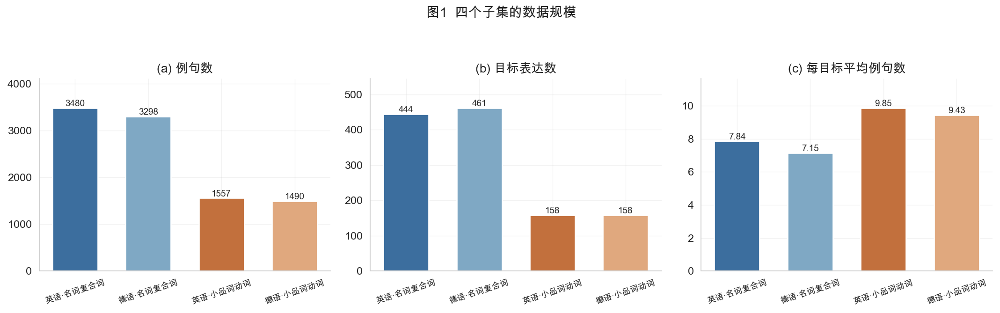

| 子集 | 例句数 | 目标表达数 | 每目标例句数 | 评分均值 | 组内标注 SD 均值 |
|---|---|---|---|---|---|
| 英·名词复合词 `en-nn` | 3,480 | 444 | 7.84 | 3.79 | 0.51 |
| 德·名词复合词 `de-nn` | 3,298 | 461 | 7.15 | 3.96 | 0.31 |
| 英·小品词动词 `en-pv` | 1,557 | 158 | 9.85 | 2.46 | 0.75 |
| 德·小品词动词 `de-pv` | 1,490 | 158 | 9.43 | 2.63 | 0.63 |

**审计结论（全部通过）**：`ContextID` 无重复、无空值；重复例句仅 4 条（`en-nn`）+ 1 条（`en-pv`），占比 0.1%，可直接去重。

### 1.1 【v2】全量规模与官方划分协议

上表只是**训练部分**。官方明细页公布的完整结构如下（单位：唯一目标数 / 例句总数）：

| 阶段 | 发布日期 | EN NN | EN PV | DE NN | DE PV |
|---|---|---|---|---|---|
| Trial | 2026-09-05 | 2 / 10 | 2 / 10 | N/A | N/A |
| **Training** | 2026-09-08 | 444 / 3,480 | 158 / 1,557 | 461 / 3,298 | 158 / 1,490 |
| **Evaluation** | 2027-01-10 | 116 / 908 | 42 / 414 | 118 / 833 | 42 / 400 |
| **合计** | — | **560 / 4,388** | **200 / 1,971** | **579 / 4,131** | **200 / 1,890** |
| | | **1,539 目标 / 12,380 例句** | | | |

对预处理有实质影响的三点：

1. **测试集 = 318 目标 / 2,555 例句**，占全量约 21%——与「目标级 80/20 互斥」完全吻合，**实证确认划分发生在目标层面**（若按行划分，测试集例句数会远大于这个比例）。
2. **每个目标 = 5 条当代 + 5 条历史**，因历史数据稀疏而未满 10 条（官方称均值约 9）。本地实测训练集均值 **8.05**，其中 **`de-nn` 的 7.15 条/目标最稀疏**——这是德语复合词方向的首要数据瓶颈。
3. **Trial 的 2+2 个目标不属于主数据集**，任何统计都要排除。
4. **测试集不含 `*Avg` / `*Std` 列**，但含 `ContextID` 与 `Context`。这意味着**训练与推理的列集合不同**，管线读入测试集时必须容忍缺列（见 §9）。

**官方划分协议（三条，本地必须复现）**：

- 目标级 80/20 互斥：train/test 的目标集合不重叠；
- **先按组合性分箱，再从各箱分层抽样**，以保证两侧金标准分布一致；
- 四个 language/subtask 组合**各自独立划分**。


---

## 2. 环节 ①：行序泄漏 —— 本计划最重要的发现

### 2.1 现象

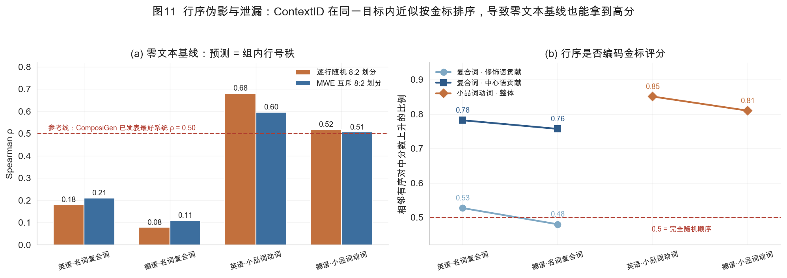

**左图 (a)** 是一个**完全不使用任何文本内容**的基线：预测分数 = 该行在所属目标内的序号秩，线性映射到 0–5。

| 子集 | 全量 ρ | 逐行随机 8:2 | MWE 互斥 8:2 |
|---|---|---|---|
| `en-nn` | 0.187 | 0.180 | 0.211 |
| `de-nn` | 0.127 | 0.079 | 0.110 |
| **`en-pv`** | **0.623** | **0.682** | **0.596** |
| **`de-pv`** | **0.521** | **0.519** | **0.507** |

作为标尺：ComposiGen（LREC 2026）已发表的最好系统是 **ρ = 0.50**；Couch Potato（ACL 2025）的纯文本 Skip-gram 是 0.565。

> **也就是说：在两个小品词动词子集上，一个连句子都不看的平凡基线，已经达到了已发表最好系统的水平。**

### 2.2 成因：行序编码的是金标，不是年代

**右图 (b)** 显示，同一目标内相邻行的分数上升比例：

| 标签列 | 相邻上升对占比 | 组内 Spearman(ContextID, 分数) | ρ>0.5 的目标占比 |
|---|---|---|---|
| 复合词 · **修饰语**贡献 `ModAvg` | 0.48–0.53（≈随机） | 0.22–0.30 | 30–34% |
| 复合词 · **中心语**贡献 `HeadAvg` | 0.76–0.78 | **0.976–0.985** | **100%** |
| 小品词动词 · 整体 `Avg` | 0.81–0.85 | **0.990–0.994** | **100%** |

**排除了「年代序」这一解释**，三条独立证据：

1. **句中显式年份与 `ContextID` 几乎零相关**：`en-nn` Pearson = +0.034、`de-nn` = −0.015、`en-pv` = +0.079、`de-pv` = −0.128。
2. **同一目标内，年份秩与 ContextID 秩的相关为负**（`de-nn` 20 个可测样本中 75% 为负）。
3. **逐条人工核验**：`brass ring` 的第 2 行提到 Rihanna（2000 年代），第 5 行是 19 世纪小说——顺序与年代相反。

**结论**：行序近似编码的是**中心语贡献（复合词）/ 整体评分（小品词动词）**，而**修饰语贡献是随机顺序**。这个非对称性本身就说明它是数据构造过程的产物，不是语言现象。

### 2.3 为什么必须立刻处理

- **随机划分不会暴露问题**：左图两列数值接近，说明无论怎么随机切分，这个捷径都照样生效。**常规验证协议无法自证清白。**
- **MWE 互斥划分也挡不住**：因为该捷径只用到了「组内相对次序」，在完全没见过的目标上依然有效（0.596 / 0.507）。

### 2.4 预处理规定

| 规则 | 说明 |
|---|---|
| **R1.1 丢弃 `ContextID`** | 载入后立即删除该列；不要用它派生任何特征 |
| **R1.2 载入即打乱** | 读完 TSV 后立刻 `sample(frac=1, random_state=42)`，打乱物理行序 |
| **R1.3 禁止行号衍生特征** | 组内序号、文件内绝对位置、与相邻行的差分——一律不得入模 |
| **R1.4 自检基线** | 每次建管线先跑「组内秩」基线；若某模型的分数低于它，说明管线有 bug |
| **R1.5 论文中报告自检值** | 把 0.62/0.52 作为已知地板写进方法节，提醒读者不要误读 |

---

## 3. 环节 ②：目标表达定位 —— 让模型知道「词在哪」

由于 66%–79% 的例句里找不到目标词的字面形式（英语 PV 屈折、德语可分动词分离），**定位失败等于该例句直接报废**。

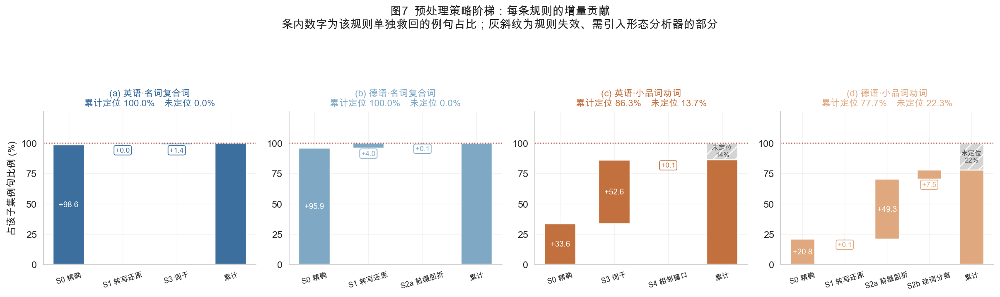

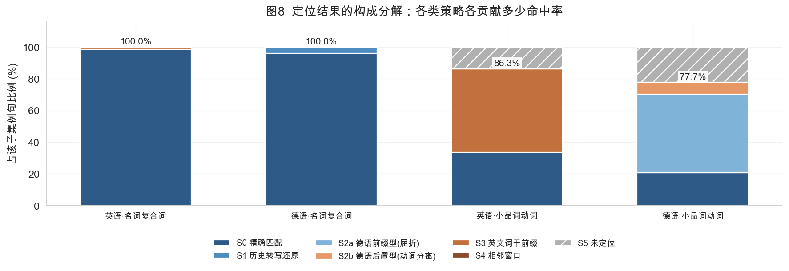

### 3.1 四级级联策略（成本从低到高，逐级兜底）

| 级别 | 策略 | 英语 NN | 德语 NN | 英语 PV | 德语 PV |
|---|---|---|---|---|---|
| **S0** | 精确子串匹配（容许连字符/空格变体） | 98.6% | 95.9% | 33.6% | 20.8% |
| **S1** | 历史转写还原（`ß→ss`、`ä→ae`，NFKD 折叠） | +0.0 | **+4.0** | +0.0 | +0.1 |
| **S2a** | 德语前缀型：粒子黏着词首 + 词干前缀命中 | — | +0.1 | — | **+49.3** |
| **S2b** | 德语后置型：动词与粒子分离（`klingen … ab`） | — | +0.0 | — | **+7.5** |
| **S3** | 词干前缀匹配（取词干前 5/4/3 字符） | **+1.4** | +0.0 | **+52.6** | — |
| **S4** | 相邻双词窗口 | +0.0 | +0.0 | +0.1 | — |
| **累计** | | **100.0%** | **100.0%** | **86.3%** | **77.7%** |

### 3.2 四类失配的形态学归因

| 类型 | 实例 | 受影响子集 |
|---|---|---|
| 名词复合词复数 | `canal company` → `canal companies` | 全部 `nn` |
| 英语动词屈折 | `boil down` → `boiled down`；`strike down` → `struck down` | `en-pv` 主体 |
| 德语 `zu` 不定式 | `abwickeln` → `abzuwickeln` | `de-pv` |
| 德语 `ge-` 完成体 | `abhauen` → `abgehauen`；`ablehnen` → `abgelehnt` | `de-pv` |
| 德语变音丢失（历史拼写） | `drücken` → `drucken`；`Arbeitsfähigkeit` → `Arbeitsfaehigkeit` | `de-nn` 4.0%、`de-pv` |

### 3.3 预处理规定

| 规则 | 说明 |
|---|---|
| **R2.1** | 实现上表的级联策略，**记录每条例句命中的策略级别**，作为一列元数据输出 |
| **R2.2** | 德语 NN / PV 的未定位比例（0% / 22.3%）不得静默丢弃 |
| **R2.3** | 对 `de-pv` 剩余 22.3%，接入真正的形态分析器（推荐 **RPN** 或 **DeepMorph**）做有限形式还原；实测德语子集仅 332 例，但它们恰好是**最难的小品词动词**（如 `ablehnen → abgelehnt`），丢弃会系统性损失信号 |
| **R2.4** | 英语 PV 的剩余 13.7% 同理，建议用 **Stanford CoreNLP / spaCy lemmatization** 后重试 |
| **R2.5** | 定位失败率按子集分别报告，作为数据质量指标写进论文 |

---

## 4. 环节 ③：括号处理 —— 一条需要纠正的直觉

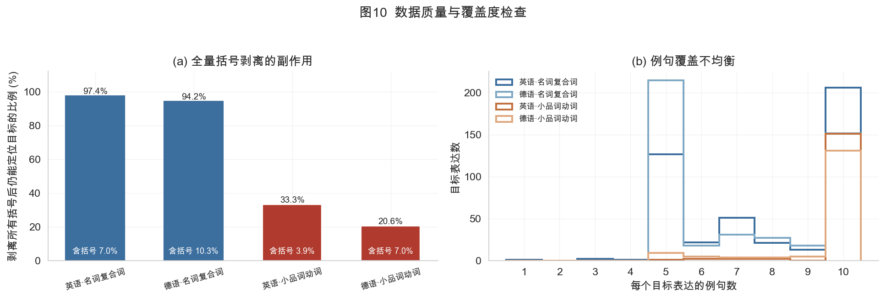

**常见误判**：「句尾的 `(目标词 )` 是标注标记，应统一剥离」。

**实测结果推翻了这个假设**：

| 检查项 | `en-nn` | `de-nn` | `en-pv` | `de-pv` |
|---|---|---|---|---|
| 含括号的例句比例 | 7.0% | 10.3% | 3.9% | 7.0% |
| 句尾以 `)` 结尾的例句数 | **2** | **6** | **5** | **5** |
| 末位括号内容 == 目标词 | **0/2** | **0/6** | **0/5** | **0/5** |

**这些括号是语料原文中正当的括注**，内容是文献引用、计量单位、旁注等：

| 子集 | 括号内容示例 | 对应目标 |
|---|---|---|
| `en-nn` | `(looking at my account book` | `account book` |
| `de-nn` | `(60 x 34 cm` | `ablagefläche` |
| `en-pv` | `(when she settles down...` | `settle down` |
| `de-pv` | `(und es ist ihr reiz` | `abstecken` |

左图 (a) 显示：**无条件剥离所有括号后，`en-pv` 有 66.7% 的例句再也定位不到目标**（德语 PV 为 79.4%），因为剥离会连带删掉句中真正承载目标词的那一段。

### 4.1 预处理规定

| 规则 | 说明 |
|---|---|
| **R3.1** | **不要**做正则全量括号剥离 |
| **R3.2** | 若确需清理，只处理末尾形如 `( … )` 且**内层长度 ≤ 目标词长度 + 2** 的单个括号；本数据上此规则命中 0 例，实际等同于不做 |
| **R3.3** | 在 `Context` 之外另存一份 `Context_raw`，保证可回溯 |
| **R3.4** | 定位一律在**原文偏移**上完成（脚本里的 `locate()` 返回 `(start, end)` 字符区间），不要在归一化后的字符串上做，否则词边界会被破坏 |

---

## 5. 环节 ④：标签结构与建模准备

### 5.1 评分分布的严重不均衡

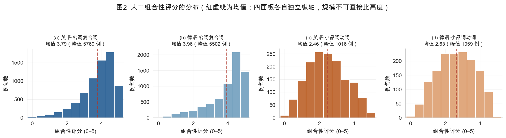

- `de-nn` 有 **58.7%** 的评分落在 [4,5)，均分 3.96
- `en-pv` 有 **34.7%** 落在 [0,1)，均分 2.46
- 全局四子集合计的分布跨度远大于任一子集内部

> **直接用统一 MSE 训练，梯度会被 `de-nn` 主导**，而 `de-nn` 恰恰是四个子集里最简单的一个（见 §6）。

### 5.2 标签层级

| 子集 | 标签列 | 监督头 |
|---|---|---|
| `en-nn` / `de-nn` | `ModAvg`、`HeadAvg`（+ 各自 `Std`） | **两个回归头** |
| `en-pv` / `de-pv` | `Avg`（+ `Std`） | **一个回归头** |

**成分角色不对称实测**：

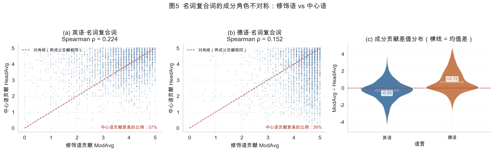

| 子集 | ModAvg 均值 | HeadAvg 均值 | 中心语更高比例 | ModAvg~HeadAvg ρ |
|---|---|---|---|---|
| `en-nn` | 3.66 | 3.91 | **57.1%** | 0.224 |
| `de-nn` | 4.32 | 3.60 | **25.5%** | 0.152 |

两个子集的中心语/修饰语优势**方向相反**，且两列评分的相关性都很低（0.15–0.22）——**二者是两个近乎独立的监督信号，不可互相替代**。

### 5.3 预处理规定

| 规则 | 说明 |
|---|---|
| **R4.1** | 保留原始两列标签，分别建头；不要合并成一个 `compound_mean` |
| **R4.2** | 损失函数按子集分组或分组加权；`de-nn` 降权 |
| **R4.3** | `Std` 只作为「样本权重」或「辅助回归目标」，**不要**用作标签平滑系数（依据见 §6.3、§6.4） |
| **R4.4** | 训练时把子集 one-hot 作为显式输入特征，或至少做分层采样 |

---

## 6. 环节 ⑤：三条必须在建模前确认的经验事实

### 6.1 语境依赖性极强，且子集间差异巨大

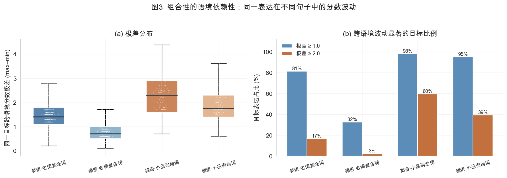

| 子集 | 跨语境极差中位数 | 极差 ≥1 的目标占比 | 极差 ≥2 的目标占比 |
|---|---|---|---|
| `en-nn` | 1.40 | 81.3% | 16.7% |
| **`de-nn`** | **0.70** | 32.5% | **2.6%** |
| **`en-pv`** | **2.30** | 98.1% | **59.5%** |
| `de-pv` | 1.75 | 94.9% | 39.2% |

**含义**：`de-nn` 基本是 type-level 稳定任务，`en-pv` 则是极端语境依赖。**总分掩盖了子集间近 20 倍的难度差**。

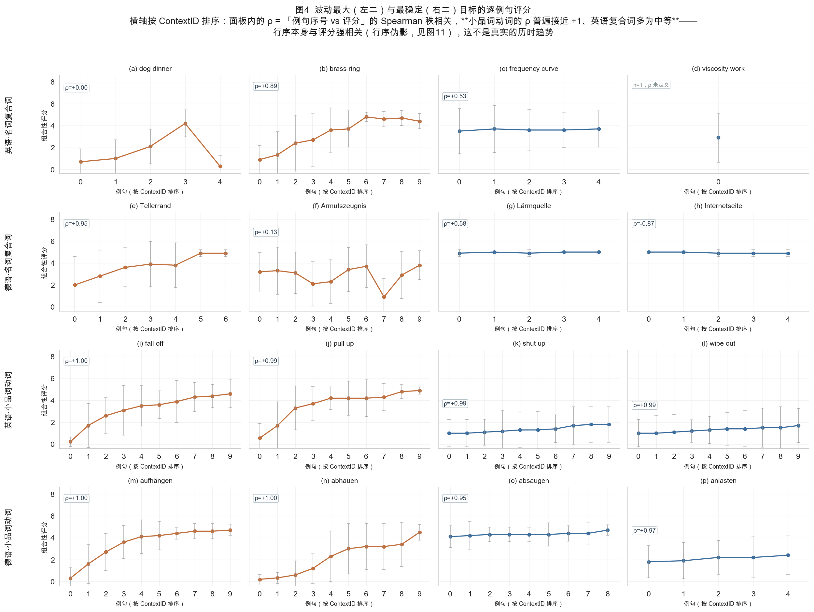

逐例句轨迹直观展示了这一点（注意后三行的单调上升是 §2 的行序伪影，不是历时趋势）。

### 6.2 每目标例句数不足以支撑 type-level 建模

`en-nn`/`de-nn` 每目标仅 5–10 条例句，其中约 23% 只有 5 条。EACL 2023 实测：10→100 条例句，Spearman ρ 从 0.622 升到 0.689（+0.067）；100→1000 只再升 0.017。**本数据正处在「例句数最稀缺」的区间** → 必须走 token-level（逐例预测 + 跨例聚合），不要试图先聚合成 type-level 分数再回归。

### 6.3 标注离散度不是脏数据

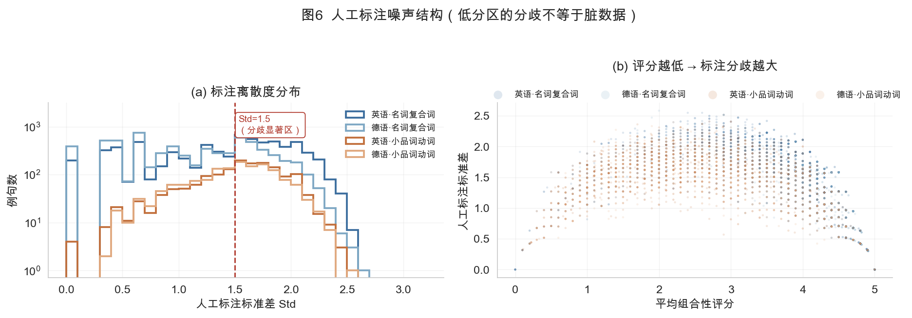

- `en-pv` 有 **60.7%** 的例句 `Std > 1.5`，`de-pv` 54.8%，`en-nn` 52.9%
- 散点图显示**评分越低，标注分歧越大**

依据 Roller, Schulte im Walde & Scheible (MWE 2013) 的噪声注入实验（把 25% 条目替换为随机值后，用 Z-score 过滤完全无法恢复一致性），这类分歧是**任务固有属性（Type I 不确定性）**，不是标注事故。

### 6.4 【v3】标签的数值构造已反解：`Std` 是 10 个评分的样本标准差

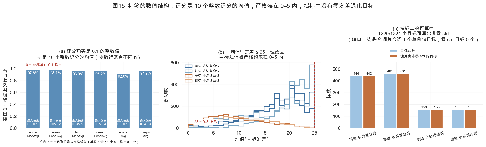

设 n 个 0–5 整数评分 x₁…xₙ，则 `Avg = S/n`（S=Σxᵢ 整数）、
`Std² = (n·Q − S²)/(n·(n−1))`（Q=Σxᵢ² 整数，ddof=1）。

**实测确认 n = 10**：`10·Avg∈ℤ`、`90·Std²∈ℤ`、`Q=(90Std²+S²)/10∈ℤ`、
以及取值范围约束 `Q≤5S ∧ Q≥S ∧ S²≤10Q` 四个矩条件在 **91.3%–97.8%** 的行同时成立；
`|90Std²−round|` 的 p90 ≈ 0.0013（浮点精度量级）；
**91.2%–97.8% 的行可完整重建出 10 个 0–5 整数评分**（重建误差 ≤2.3e-2，来自 6 位小数舍入）。

**因此：均值自身的抽样噪声方差 = `Std²/10`，不是 `Std²`。**
此前把 `Std²` 直接当作「均值噪声」是把噪声**高估了 10 倍**。

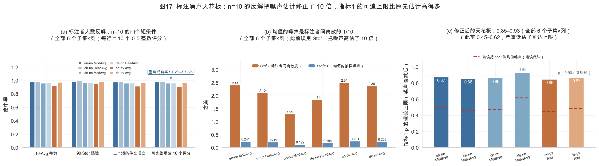

| 子集/列 | `Std²` | `Std²/10`（均值噪声） | 目标级信号方差 | 信噪比 | **修正后 ρ 上限** | 误用 `Std²` 的错误值 |
|---|---|---|---|---|---|---|
| en-nn Mod / Head | 2.406 / 2.116 | 0.241 / 0.212 | 0.771 / 0.576 | 3.21 / 2.72 | **0.873 / 0.855** | 0.493 / 0.463 |
| de-nn Mod / Head | 1.291 / 1.844 | 0.129 / 0.184 | 0.370 / 1.125 | 2.87 / 6.10 | **0.861 / 0.927** | 0.472 / 0.616 |
| en-pv / de-pv Avg | 2.509 / 2.380 | 0.251 / 0.238 | 0.629 / 0.727 | 2.51 / 3.05 | **0.845 / 0.868** | 0.448 / 0.484 |

**含义：指标 1 的 ρ 理论上限是 0.85–0.93，不是 0.46–0.62。**
「模型只做到 ρ=0.6」**不是标签噪声的锅**，调参时不要在 0.6 附近误判为到顶。

> **图 17 口径**：三个面板 (a)(b)(c) **全部覆盖 6 个「子集×列」**，与上表逐项一致；
> (c) 的 6 根柱依次为 `en-nn` Mod/Head、`de-nn` Mod/Head、`en-pv` Avg、`de-pv` Avg。

另有两条标签结构事实：

- `mean² + std² ≤ 25` 在四子集**零行超界**（上界恰在 25.0000 取到）→ 标注值严格约束在 0–5 内
- **零 std 目标 0 个**（en-nn 443/444、de-nn 461/461、en-pv 158/158、de-pv 158/158）
  → 指标 2 的被解释变量**无零方差退化点**，风险全在模型侧（输出恒定 → std≡0 → `nan`）
- 零 std **行**存在（de-nn ModAvg 有 7.34% 的行 `Std=0`，即 10 位标注者全给同一分）
  → 这些行**噪声为零**，应保留且**不加权**

### 6.5 预处理规定

| 规则 | 说明 |
|---|---|
| **R5.1** | 划分必须按 `Compound`/`ParticleVerb` **分组互斥**；复合词子集内同一 MWE 的行是连续的（图 11(b) 的 `de-nn` 显示 `contiguous_within_mwe = true`），逐行随机划分会造成同目标跨划分泄漏。**【v2】此规则已被官方协议证实**：官方明确「splits do not overlap in targets and each split therefore contains all example sentences of its targets」 |
| **R5.2** | 另做一组「未见目标（unseen MWE）」评估，作为泛化能力的单独指标。**【v2】这一组正是官方 80/20 划分所衡量的能力**，本地 dev 的互斥程度越高，调参结论越可迁移 |
| **R5.3** | 训练时用 `Std` 做样本加权（高分歧样本降权），但**保留全部样本**，不做阈值剔除 |
| **R5.4** | 所有结果必须按 `语言 × MWE类型` 四格分层报告，总分只作为附加项。**【v2】** 官方在四格之上还拆出 NN 的 modifier/head 两列，实际报告 **6 格 + 跨格均值** |
| **R5.5 【v2】** | **本地 dev 必须复刻官方的「先分箱、再分层抽样」**：把 `ModAvg`/`HeadAvg`/`Avg` 按固定边界切成若干箱（如 0–1 / 1–2 / 2–3 / 3–4 / 4–5），在**目标层面**按箱配额抽样。不这样做，本地 dev 的金标准分布会与官方 test 不同，所有超参选择都不可迁移 |
| **R5.6 【v2】** | 四个 language/subtask 组合**各自独立划分**，不要跨子集合并后统一抽样——官方就是这么做的，且四者分布差异巨大（§6.1） |
| **R5.7 【v3】** | 标签是 **10 个 0-5 整数评分的均值**（ddof=1 的 `Std`）→ 回归头输出**连续值 + 辅助头**，不要把标签当离散投票做分类/softmax |
| **R5.8 【v3】** | 样本权重用 `w = 1/(1+Std/2)`（`Std` 越大降权），**`Std=0` 的行不加权**——它们噪声为零，是高质量样本 |
| **R5.9 【v3】** | 损失函数用三段式：`L = L_rank(组内成对排序) + λ·L_reg(绝对值) + μ·L_std(目标级 std 辅助头)`。成对排序对 `Std²/10` 的噪声不敏感，且天然有利于指标 2 |
| **R5.10 【v3】** | `Std` **绝不可用作标签平滑系数**——平滑会直接压平输出方差，伤害指标 2 |
| **R5.11 【v3】** | 调参时的**可达上限参考值是 0.85–0.93**（不是 0.46–0.62）。ρ 低于 0.6 说明模型能力不足，不应归因于标签噪声上限 |

---

## 7. 环节 ⑥：三项评测指标的实测可达成性（依官方竞赛页修订）

官方公布了三项指标，本节给出在本地训练集上的实测。

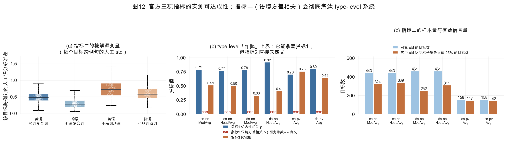

### 7.1 指标一（组合性相关 ρ）与指标三（RMSE）：type-level 拿得到高分

构造一个「作弊上界」——**每条例句都填该目标的真实均值**（等于作弊式地知道了每个目标的答案）：

| 子集 | 标签列 | 指标1 ρ | 指标3 RMSE |
|---|---|---|---|
| 英·复合词 | `ModAvg` | 0.790 | 0.512 |
| 英·复合词 | `HeadAvg` | 0.771 | 0.502 |
| 德·复合词 | `ModAvg` | 0.780 | 0.329 |
| 德·复合词 | `HeadAvg` | **0.918** | 0.407 |
| 英·小品词动词 | `Avg` | 0.702 | 0.756 |
| 德·小品词动词 | `Avg` | 0.798 | 0.640 |

**含义**：指标 1 与 3 **单独看并不强制你使用语境**——只要能猜对每个目标的均值，就能拿 ρ ≈ 0.70–0.92。这也再次印证了报告分层结果的重要性：德语·中心语的 0.918 明显高于其他设置。

### 7.2 指标二（语境方差相关）：type-level 直接出局

指标 2 的定义是：对每个目标，算系统分数跨其所有例句的 **std**，再与人工评分的对应 std 算 Spearman ρ。

**上表的所有 type-level 方案，指标 2 全部为 `nan`**——因为每个目标内所有预测值相同，std 恒为 0，相关系数的输入数组是常数。

> **这是本任务最有辨识度的设计：指标 2 把「你到底用没用语境」变成了硬性门槛。**
> 在指标 1 上表现不错的 type-level 系统，会在指标 2 上直接失去名次。

### 7.3 指标二的被解释变量有多大？

每个目标跨例句的人工评分 std 分布（这正是指标 2 的金标准向量）：

| 子集 | 标签列 | 可算 std 的目标数 | std 中位数 | std 均值 | std 最大 | 变异系数 |
|---|---|---|---|---|---|---|
| 英·复合词 | `ModAvg` | 443 | 0.476 | 0.510 | 1.569 | 0.13 |
| 英·复合词 | `HeadAvg` | 443 | 0.472 | 0.496 | 1.391 | 0.12 |
| 德·复合词 | `ModAvg` | 461 | 0.279 | 0.305 | 1.052 | 0.08 |
| 德·复合词 | `HeadAvg` | 461 | 0.365 | 0.378 | 1.106 | 0.10 |
| **英·小品词动词** | `Avg` | 158 | **0.730** | **0.750** | 1.637 | **0.30** |
| 德·小品词动词 | `Avg` | 158 | 0.578 | 0.627 | 1.506 | 0.24 |

**要点**：

1. **英语小品词动词的 std 中位数 0.730，是德语复合词修饰语（0.279）的 2.6 倍**——再次印证 `en-pv` 是最语境依赖的子集，也意味着指标 2 在这个子集上最有区分度。
2. **样本量落差明显**：复合词每个设置 443–461 个目标，足够稳健；小品词动词只有 **158** 个。指标 2 在 PV 上的方差会比较大，不要过度解读 0.05 量级的差异。
3. **几乎没有目标只有 1–2 条例句**（仅 `en-nn` 有 1 个目标仅 1 条例句，std 无法定义），所以指标 2 几乎不会因样本不足而 `nan`——**除模型本身输出常数外**。

### 7.4 预处理规定（新增）

| 规则 | 说明 |
|---|---|
| **R7.1 绝对禁止输出常数** | 每条例句的预测分必须随语境变化；否则指标 2 直接 `nan`，等于放弃一个指标 |
| **R7.2 指标 2 只能通过建模获得** | 不能靠后处理加噪声来「制造」方差——那会同时抬高 std 却破坏指标 1 的排序；正确做法是让模型真正对语境敏感 |
| **R7.3 把目标级 std 当作辅助监督** | 训练数据里每条都有 `Std`（标注者间标准差），目标级 std 可由 `groupby(target)[label].std()` 直接算出。建议加一个**辅助回归头**，以 `(目标级人工 std)` 为目标预测量，与主任务联合训练 |
| **R7.4 用成对排序损失时会自然受益** | 做法 B（同目标内成对比较）只关心**目标内部**的相对顺序，对绝对幅度不敏感，因此天然有助于指标 2；做法 A（回归绝对值）则必须显式控制输出方差 |
| **R7.5 本地自检必须复现三个指标** | 下载试测提交返回的 `scores.txt`，把自己的本地实现与之对齐；**三个指标都要算，不要只算 ρ** |
| **R7.6 报告时同时给出六格 + 均值** | 官方会同时报「各设置单独分」与「跨设置均值」，后者对出题系统更友好 |

### 7.5 两个指标的潜在冲突

指标 1/3 奖励**跨目标的数值校准**，指标 2 奖励**目标内部的离散程度**，二者存在张力：

- 过度压缩输出方差 → 指标 2 掉分
- 过度放大方差 / 加噪声 → 指标 1 的排序被破坏、RMSE 变差

**建议的调参方式**：把「输出缩放系数」当作一个显式旋钮，在 dev 上画 **指标1 ρ vs 指标2 ρ 的帕累托前沿**，而不是用单一验证指标选点。这也是论文里一个可以写的分析点。

---

## 8. 环节 ⑦：构建年代代理（数据无年代字段）

官方页面说明数据混合了当代与历史语料，但 TSV 中**没有任何年代列**；且官方明确表示**测试样本的时间来源不会公开**，目的是鼓励设计对两类时期都鲁棒的系统（他们会在最终报告中补充按时间来源的分析）。§2.2 已证明 `ContextID` 不能用做年代。可用的表层代理：

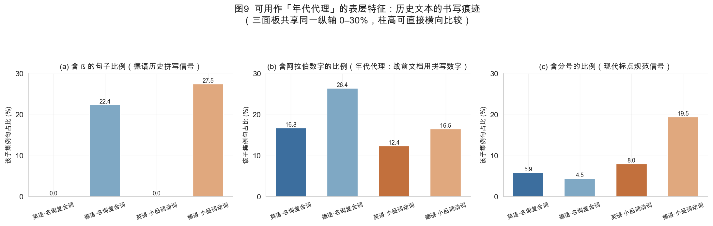

| 特征 | `en-nn` | `de-nn` | `en-pv` | `de-pv` |
|---|---|---|---|---|
| 含 `ß` 的句子比例 | 0% | 22.4% | 0% | 27.5% |
| 含阿拉伯数字的比例 | 16.8% | **26.4%** | 12.4% | 16.5% |
| 含分号的比例 | 5.9% | 4.5% | 8.0% | **19.5%** |
| 含变音字符比例 | 0% | 84.2% | 0% | 78.3% |
| 平均句长（词） | 25.4 | 23.0 | 24.4 | 23.5 |

`ß` 与「ASCII 转写」（`ae`/`oe`/`ue` 替代变音，德语 6.7%–7.1% 的句子）是最强的历史信号——`Arbeitsfähigkeit` 与 `Arbeitsfaehigkeit` 在同一份数据里并存。

| 规则 | 说明 |
|---|---|
| **R8.1** | 用上述特征构造一个「年代代理」`era_proxy`（可直接用 `ß`/ASCII 转写规则，也可用小型分类器），**仅用于分层评估与误差分析** |
| **R8.2** | 报告「模型在 `era_proxy` 两端上的性能差」，这是本任务区别于普通组合性预测的卖点；也呼应官方「会在最终分析中补充按时间来源的统计」 |
| **R8.3** | 不得使用**任何给定的年代元数据**（测试集本来也不公开）。**基于文本表面推断**的年代特征不属于此类，原则上允许——但见 §8.1 的实测结论，本数据上收益极小且方向不稳，**默认不入模**；若要入模，必须先在 dev 上证明它能同时改善指标 1 与指标 2，而不是只改善某一格 |
| **R8.4** | 不允许用年代相关特征去「制造」指标 2 所需的方差——实测证明这条路不通，且会污染指标 1 |

### 8.1 【v2】实测：年代信号不能解释目标内方差，也刷不了指标 2

官方披露的「每目标 5 条当代 + 5 条历史」引出一个值得验证的假设：

> 同一目标内天然混有两个年代的例句，而指标 2 衡量的正是「目标内 std 与人工 std 的相关」。那么只要能**判断一句是当代还是历史**，让输出在这个方向上离散，就可能白拿一部分指标 2 分数。

我为此写了一个纯表层启发式打分器 `era_score`（只用句子表面，不用任何元数据）：显式年份 + 英语现代词表/古拼写正则 + 缩写撇号；德语用显式年份 + `ß` + 无变音时的 ASCII 转写（`ae/oe/ue`）。

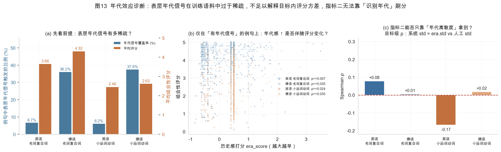

| 子集 | 标签列 | 覆盖率 | 信号子集内全局 ρ | 目标内 ρ 均值 | 目标级 ρ（era.std vs 人工 std） |
|---|---|---|---|---|---|
| 英·复合词 | `ModAvg` | 6.7% | +0.007 | +0.028 | +0.078 |
| 英·复合词 | `HeadAvg` | 6.7% | −0.033 | −0.040 | −0.096 |
| 德·复合词 | `ModAvg` | 36.2% | +0.035 | −0.019 | +0.006 |
| 德·复合词 | `HeadAvg` | 36.2% | −0.110 | −0.024 | +0.153 |
| 英·小品词动词 | `Avg` | 6.2% | +0.024 | −0.008 | **−0.169** |
| 德·小品词动词 | `Avg` | 37.6% | +0.035 | +0.066 | +0.018 |

**结论：捷径不成立。三条证据：**

1. **信号太稀疏**——英语只有 6.2%–6.7% 的例句能被触发，德语也只有 36%–38%。
2. **相关性全在噪声区间**——所有 |ρ| ≤ 0.17。
3. **方向不稳定**——德语 Head 上「年代感越高评分越低」看着成立（ρ = −0.110），但同一列的目标级离散度却是**正**相关（+0.153）；`en-pv` 更是显著为负（−0.169）。跨子集、跨列符号翻转，说明这是采样噪声而非机制。

**因此 R8.3 的实操结论是：年代代理留在评估层，不进模型。** 这也反过来证明**指标 2 是一个真正有区分度的指标**——它既淘汰 type-level 常数输出，也无法被表面特征糊弄，只能靠真正的逐例句语境敏感性拿到（见 §7.2、R7.1–R7.4）。

> 若将来想更认真地做历时鲁棒性，正确做法不是「猜年代当特征」，而是**在能拿到元数据的训练集上构造「当代 / 历史」二分类的域对抗或分组归一化目标**，再用文本层面的**归一化**（而非年代本身）作为鲁棒手段。相关文献依据见综述方向 5 与 §3.4。

---

## 9. 【v2】推理输出契约与提交格式规范

这一节以前不存在——因为此前只知道有指标、不知道要交什么。提交格式是**最容易在最后一天翻车**的环节，因此单列。

### 9.1 官方规定（原文要点）

- 提交物是**一个 zip 包**，内含文件名格式为 `[language]-[task]-pred.tsv` 的文本文件。
- 因此合法文件名**只有 4 个**：

| 文件名 | 对应评测设置 |
|---|---|
| `en-nn-pred.tsv` | 英语·复合词·**修饰语** + 英语·复合词·**中心语**（同一文件的第 2、3 列） |
| `en-pv-pred.tsv` | 英语·小品词动词 |
| `de-nn-pred.tsv` | 德语·复合词·修饰语 + 德语·复合词·中心语 |
| `de-pv-pred.tsv` | 德语·小品词动词 |

- **不含表头（no header）。**
- 每行一条预测，制表符分隔：

| 类型 | 列数 | 每行内容 |
|---|---|---|
| 名词复合词 | **3** | `ContextID` ⇥ `modifier 预测` ⇥ `head 预测` |
| 小品词动词 | **2** | `ContextID` ⇥ `单一预测` |

- **测试集不含 `*Avg` / `*Std` 列**，但含 `ContextID` 与 `Context`。

### 9.2 由此推出的工程约束

| 规则 | 说明 |
|---|---|
| **R9.1** | 推理入口要**容忍缺列**：读入测试 TSV 时 `ModAvg`/`HeadAvg`/`Avg`/`Std` 不存在，载入逻辑不得无条件引用这些列。用 `if c in df.columns` 或按 split 分支 |
| **R9.2** | `ContextID` 必须**原样透传**——不重编号、不去重、不排序假设、不做 `astype(int)`（可能是非数字串） |
| **R9.3** | **不写表头。** 写成 `ContextID\tModAvg\tHeadAvg` 会让评测脚本把这一行当成一条预测而整体错位，后续所有行全部串位，且**不会报格式错误**，只会静默给出离谱分数 |
| **R9.4** | NN 的第 2、3 列顺序是 **modifier 在前、head 在后**，不可与 TSV 列序混用。**建议在导出函数里写单元测试**，对同一行分别导出并断言列序 |
| **R9.5** | 预测值**保持在 0–5 原尺度**。若训练时做了标准化/校准，导出前必须反变换——RMSE 对尺度错误是灾难性的 |
| **R9.6** | 导出后做**逐行断言**：行数 = 测试集行数；每行字段数 = 3 或 2；无 NaN/inf；数值在 [0,5]；`ContextID` 集合与测试集**完全相等** |
| **R9.7** | 输出**不得为常数**（否则指标 2 = nan，见 §7.2 / R7.1）；导出前显式断言组内标准差非零 |
| **R9.8** | 尽早用掉 **Trial（仅英语）** 的 `scores.txt`：这是校验本地指标实现与官方实现是否一致的**唯一官方渠道**（2026-09-05 起可提交） |

### 9.3 最小导出骨架

```python
# 导出前自检（任何一条不满足都应直接 raise，而不是让它走到提交）
def export_pred(tsv_path, preds_nn, preds_pv=None, lang="en", task="nn"):
    test = pd.read_csv(tsv_path, sep="\t")           # R9.1 缺 Avg/Std 列也能读
    ids  = test["ContextID"].astype(str)             # R9.2 原样透传
    if task == "nn":
        assert len(preds_nn) == len(test)
        body = pd.DataFrame({"ContextID": ids,
                             "mod": preds_nn[:, 0],  # R9.4 修饰语在前
                             "head": preds_nn[:, 1]})
    else:
        body = pd.DataFrame({"ContextID": ids, "pred": preds_pv})
    v = body.select_dtypes("number")
    assert np.isfinite(v.to_numpy()).all() and v.to_numpy().min() >= 0 and v.to_numpy().max() <= 5  # R9.5/R9.6
    out = f"{lang}-{task}-pred.tsv"                  # R9.8 文件名规范
    body.to_csv(out, sep="\t", index=False, header=False)   # R9.3 不写表头
    return out
```

---

## 10. 预处理流水线（伪代码）

```python
# ── 阶段 0：载入与去泄漏 ─────────────────────────────
for name in ["en-nn", "de-nn", "en-pv", "de-pv"]:
    df = pd.read_csv(f"train/{name}-train.tsv", sep="\t")
    df = df.drop_duplicates(subset=["Context", key])      # 仅 5 条重复
    df["Context_raw"] = df["Context"]                    # 保留原文，不剥括号
    df = df.sample(frac=1, random_state=42)              # R1.2 物理打乱
    df = df.drop(columns=["ContextID"])                  # R1.1 丢弃行号

# ── 阶段 1：定位（级联，逐级兜底）─────────────────────
for row in df.itertuples():
    strategy, span = locate(target, base, particle, lang, row.Context)
    df.loc[i, ["hit_start", "hit_end", "locate_strategy"]] = (*span, strategy)

# ── 阶段 2：文本归一化（保留原文偏移映射）────────────
df["text_norm"] = df["Context_raw"].map(lambda s: NFKD_fold(s))   # 仅用于检索
df["text_clean"] = df["Context_raw"].str.strip()                   # 送入模型用这个

# ── 阶段 3：标签与权重 ───────────────────────────────
df["y_mod"], df["y_head"] = df.ModAvg, df.HeadAvg       # nn：两列都留
df["w"] = 1.0 / (1.0 + df["Std"])                        # 高分歧降权
df["subset"] = name                                     # 显式特征 / 分层采样

# ── 阶段 4：划分 ─────────────────────────────────────
# R5.1 按 MWE 分组互斥；R5.5/R5.6 复刻官方协议：
#   先按组合性分箱，再在目标层面按箱配额分层抽样；
#   四个 language/subtask 组合各自独立划分。
# 另留 20% 目标作 unseen 集（R5.2）
```

---

## 11. 验收清单（每次跑管线逐条核对）

- [ ] `ContextID` 列已删除，全管线无行号衍生特征
- [ ] 「组内秩」自检基线已跑出，数值与 §2.1 表一致（`en-pv` ≈ 0.62）
- [ ] 未做全量括号剥离；`Context_raw` 已保留
- [ ] 定位成功率按子集报告：目标 ≥ 100% / 100% / 86% / 78%
- [ ] 训练/验证按 MWE 互斥划分；另有 unseen-MWE 集
- [ ] 复合词保留 `ModAvg` 与 `HeadAvg` 两个头
- [ ] `Std` 用于样本加权而非标签平滑，未剔除任何样本
- [ ] 结果按四格分层报告，并单独报告「历史 vs 当代」分层
- [ ] 至少一个模型在 `era_proxy` 高/低两端都做过性能对比（仅用于分层，不入模）
- [ ] **本地实现能同时算出三项指标**（ρ / 语境方差 ρ / RMSE），并已与试测 `scores.txt` 对齐
- [ ] 已确认输出**不是常数**（否则指标 2 为 nan）
- [ ] 已尝试用目标级人工 std 做辅助监督头
- [ ] **【v3】已确认 `Std` 只用于样本权重/辅助目标，未用作标签平滑**（R4.3 / R5.10）
- [ ] **【v3】损失函数为三段式**（排序 + 绝对值 + 目标级 std 辅助头），未只用单一 MSE（R5.9）
- [ ] **【v3】调参时以 ρ 上限 0.85–0.93 为参考，未误判 0.6 为天花板**（R5.11）
- [ ] **【v2】本地 dev 划分复刻了「分箱 + 分层抽样」**，且四个子集各自独立划分（R5.5 / R5.6）
- [ ] **【v2】推理入口能在缺 `*Avg`/`*Std` 列的测试集上跑通**（R9.1）
- [ ] **【v2】导出函数已写单元测试**：文件数 = 4、文件名规范、无表头、NN 列序为 mod→head（R9.3 / R9.4）
- [ ] **【v2】导出前断言全部通过**：行数、字段数、无 NaN/inf、值域 [0,5]、`ContextID` 集合与测试集完全相等（R9.6）
- [ ] **【v2】已确认年代代理列未进入模型输入**，仅用于分层评估（R8.3 / §8.1）

---

## 12. 图目录

| 图 | 文件 | 内容 |
|---|---|---|
| 1 | `reports/figures/fig1_overview.png` | 四个子集的规模对比 |
| 2 | `reports/figures/fig2_score_dist.png` | 评分分布与不均衡 |
| 3 | `reports/figures/fig3_context_spread.png` | 跨语境分数波动（极差分布 + 显著比例） |
| 4 | `reports/figures/fig4_per_example.png` | 波动最大/最稳定目标的逐例句轨迹 |
| 5 | `reports/figures/fig5_constituent_role.png` | 修饰语 vs 中心语贡献不对称 |
| 6 | `reports/figures/fig6_annot_noise.png` | 标注离散度结构 |
| 7 | `reports/figures/fig7_locate_cascade.png` | 定位策略的增量贡献 |
| 8 | `reports/figures/fig8_locate_breakdown.png` | 定位结果构成分解 |
| 9 | `reports/figures/fig9_style_features.png` | 可用作年代代理的表层特征 |
| 10 | `reports/figures/fig10_quality.png` | 括号剥离副作用 + 例句覆盖不均衡 |
| 11 | `reports/figures/fig11_order_leakage.png` | **行序伪影与泄漏演示** |
| 12 | `reports/figures/fig12_eval_metrics.png` | **三项指标的实测可达成性（指标二会淘汰 type-level）** |
| 13 | `reports/figures/fig13_era_effect.png` | **年代效应诊断：表层年代信号稀疏，解释不了目标内方差，也刷不了指标二** |
| 14 | `reports/figures/fig14_data_structure.png` | **数据契约：列结构、成分拼接律、词序律** |
| 15 | `reports/figures/fig15_label_structure.png` | **标签数值结构：n=10 的矩条件、0–5 约束、目标级 std 可算性** |
| 16 | `reports/figures/fig16_information_gain.png` | **同目标例句的独立度与聚合潜力** |
| 17 | `reports/figures/fig17_noise_ceiling.png` | **噪声天花板：n=10 反解把噪声修正 10 倍，ρ 上限 0.85–0.93** |

---

## 附：复现方式

```bash
cd /Users/piaoxiang/Desktop/ComPartMENT
python3 scripts/run_eda.py             # 产出图1-11 + scripts/stats.json
python3 scripts/run_ctxvar.py          # 产出图12 + scripts/context_variance.json
python3 scripts/run_era_effect.py      # 产出图13 + scripts/era_effect.json
python3 scripts/run_structure.py       # 产出图14 + scripts/data_structure.json
python3 scripts/run_label_structure.py # 产出图15-17 + scripts/label_structure.json
```

依赖：`pandas`、`numpy`、`matplotlib`、`seaborn`、`scipy`。
图表使用 `Arial Unicode MS` 渲染（同时覆盖中文与德语变音符号）；若该字体缺失，脚本会自动回退到 `Hiragino Sans GB` / `Songti SC`。

> 注意：`sns.set_style()` 会覆盖 `rcParams`，字体必须在它之后设置——脚本已按此顺序编写。
> **数值标签一律加白色底框**（`bbox` + `zorder`）而非盲目位移；**图例优先移出绘图区**。
